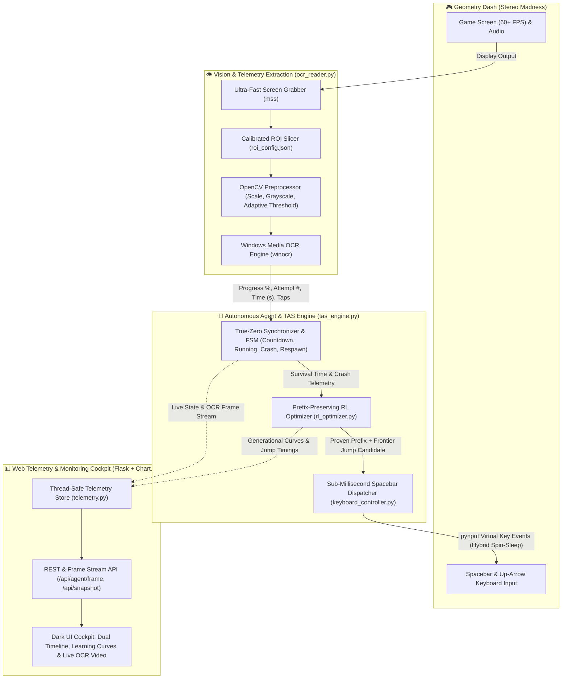

# 🚀 Geometry Dash AI — Stereo Madness Autonomous Agent & TAS

An autonomous machine-learning and Tool-Assisted Speedrun (TAS) system designed to learn, execute, and master **Geometry Dash — Stereo Madness** via non-invasive computer vision, precision hardware timing, and prefix-preserving reinforcement learning.

The system combines real-time screen capture, OCR HUD parsing, sub-millisecond precision input dispatch, and a real-time telemetry monitoring dashboard into a unified closed-loop pipeline.

---

## 📌 Project Vision & Philosophy

The project treats Geometry Dash as a strict black-box environment. It does **not** inject DLLs, inspect game process memory, or hook game internals. Instead, it operates exactly like a human player with superhuman reflex precision: **it captures the screen, parses in-game telemetry through OCR, maintains an immutable winning jump prefix, explores the frontier obstacle, dispatches sub-millisecond spacebar taps, and monitors progress through an interactive web telemetry cockpit.**



---

## ⚙️ How the Complete System Works

When fully deployed and operating, the architecture forms an autonomous continuous learning cycle:

### 1. Optical Perception & HUD Extraction (`src/hak/ocr_reader.py`)
* **Screen Buffer Grabber**: Leverages `mss` for high-frequency (60+ FPS) capture of the desktop display.
* **Calibrated Multi-ROI Slicing**: Using coordinates saved in `roi_config.json` (calibrated via the interactive `select_roi.py` snipping overlay), the reader isolates 4 key in-game HUD indicators:
  * **Level Progress %** (e.g., `73.49%`)
  * **Attempt Counter** (e.g., `Attempt 152`)
  * **In-Game Timer** (e.g., `12.45s`)
  * **Jump / Tap Counter** (e.g., `38`)
* **OpenCV Preprocessing**: Crops are upscaled 2.5× with cubic interpolation, converted to grayscale, and binarized with thresholding to eliminate background geometry noise, particles, and level pulses.
* **High-Speed OCR**: Processes frames through native OS OCR engines (Windows Media OCR / `winocr`) in under 15ms without requiring external Tesseract binaries.
* **Annotated Video Feed**: Generates live JPEG frames with color-coded bounding boxes around all active ROIs for streaming directly into the web dashboard.

### 2. Prefix-Preserving Barrier RL Optimizer (`src/hak/rl_optimizer.py`)
Stereo Madness is an 85-second deterministic rhythm obstacle course. Standard reinforcement learning algorithms that mutate early jump timings suffer from catastrophic forgetting. The system implements a **Prefix-Preserving Barrier RL Algorithm**:

$$\text{Core Rule: "Don't fix what ain't broke!"}$$

1. **Immutable Proven Prefix**: Once a sequence of jumps $[j_1, j_2, \dots, j_k]$ successfully clears obstacles up to time $T$, that prefix is **permanently frozen**. It is repeated on every subsequent run with exact timing. It is **never jittered, never shifted, and never deleted**.
2. **Targeted Frontier Exploration**: The optimizer focuses mutations strictly on the **frontier barrier** that caused the latest crash ($T_{\text{crash}}$).
3. **Adaptive Mutation Modes**:
   * **Insert Jump**: Places a new candidate jump ahead of the barrier ($T_{\text{crash}} - \Delta t$).
   * **Tune Frontier**: Shifts the timing of the most recent jump by small delta steps ($\pm 10\text{ms}$ to $\pm 35\text{ms}$).
   * **Remove Trailing Jump**: Deletes a speculative jump if it caused an immediate collision.
4. **Improvement Advancement**: A candidate jump is permanently locked into the proven prefix whenever survival time increases.

### 3. Sub-Millisecond Input Sequencer (`src/hak/keyboard_controller.py`)
Geometry Dash physics require frame-accurate input execution:
* **Hybrid Spin-Sleep Timing Engine**: Built on OS high-resolution monotonic clocks (`time.perf_counter()`). The controller sleeps for coarse intervals and spins the CPU during the final 1.5ms to eliminate OS thread scheduling jitter.
* **Dual-Key Virtual Dispatch**: Emits synchronized `Spacebar` and `Up Arrow` presses via `pynput` with microsecond accuracy.
* **Immediate Crash Abort**: When OCR signals a collision, the jump dispatcher instantly interrupts pending scheduled inputs, preventing unwanted mid-air inputs on respawn.

### 4. True-Zero Synchronization & TAS Engine (`src/hak/tas_engine.py`)
Coordinates perception, decision-making, and execution across an autonomous finite-state machine (FSM):
* **COUNTDOWN (10s Grace Period)**: Provides a countdown allowing the user to switch into Geometry Dash, select the level, and position the window.
* **RESPAWN / ZERO-SYNC**: Automatically tracks when the in-game timer resets to `0.00s` or attempt counter increments, calibrating `t0` to eliminate phase offsets.
* **RUNNING**: Executes the proven prefix and frontier jump candidate while continuously reading level progress.
* **CRASH EVALUATION**: Captures the collision timestamp, evaluates whether survival time improved, updates the genetic elite baseline, and initiates the next candidate run.
* **COMPLETION (100%)**: Detects the end of Stereo Madness (`85.0s`), locks the full TAS run, and transitions to victory state.

### 5. Web Telemetry & Monitoring Cockpit (`dashboard/`, `app.py`)
A unified Flask web application functions as the real-time mission control room:
* **Live In-Game OCR Video Stream**: Embedded `` displays live game captures with annotated ROI bounding boxes and reading diagnostics.
* **Real-Time Experiment Metrics**: Tracks current generation, attempt count, all-time best survival time, total level completions, and objective fitness.
* **Dual-View Adaptive Jump Timeline**:
  * **Desktop (>768px)**: Horizontal 85.0s rail showing planned obstacles, executed jumps with offset deltas, and live playhead.
  * **Mobile (≤768px)**: Automatically switches to a vertical top-to-bottom chronological list with auto-scrolling playhead tracking, preventing overlapping marker clutter on narrow viewports.
* **Live Operator Controls**:
  * `▶ Start RL Agent`: Triggers the configurable 10-second countdown grace period.
  * `⏸ Pause Agent` / `⏹ Halt Agent`: Instantly pauses or cancels execution.
  * `↺ Reset Elite Baseline`: Clears proven jumps to train a fresh policy from scratch.
  * `🎯 Configure ROIs`: Opens an in-dashboard modal to view, edit, or launch the interactive snipping tool.

---

## 🗂️ Project Architecture & Modules

```
hak/
├── app.py                         # Application CLI entry point & Flask server
├── pyproject.toml                 # uv project configuration & dependencies
├── requirements.txt               # Dashboard and runtime dependencies
├── roi_config.json                # Calibrated screen ROI coordinates (X, Y, W, H)
│
├── src/hak/                       # Autonomous Agent & TAS Core Modules
│   ├── __init__.py                # Package entry point
│   ├── tas_engine.py              # Main TAS Orchestrator & True-Zero FSM
│   ├── rl_optimizer.py            # Prefix-Preserving Barrier RL Optimizer
│   ├── ocr_reader.py              # Screen grabber (mss), OpenCV preprocessor & WinOCR
│   └── keyboard_controller.py     # Sub-millisecond spin-sleep spacebar dispatcher
│
├── dashboard/                     # Web Telemetry Backend
│   ├── __init__.py                # Application factory (create_app)
│   ├── routes.py                  # API routes (Status, Frame, Controls, Snapshots)
│   ├── telemetry.py               # Thread-safe in-memory TelemetryStore
│   ├── schemas.py                 # Telemetry DTOs & data schemas
│   └── simulator.py               # Fallback mock telemetry generator
│
├── templates/
│   └── dashboard.html             # Responsive dark telemetry cockpit UI
│
├── static/
│   ├── css/dashboard.css          # Dark technical theme with mobile responsive rules
│   └── js/
│       ├── chart.min.js           # Local Chart.js library
│       └── dashboard.js           # Polling loop, live video updater & dual timeline
│
├── PoCs/                          # Standalone Proof-of-Concepts & Tools
│   ├── gd_ocr_poc.py              # Standalone screen reader & WinOCR tester
│   ├── select_roi.py              # Interactive snipping tool for calibrating ROIs
│   ├── spacebar_timer.py          # Standalone keyboard timer benchmarks
│   └── test_spacebar_timer.py     # Timing accuracy unit tests
│
└── tests/                         # Automated Test Suite
    ├── test_dashboard.py          # Flask routes, API endpoints & mock simulation tests
    └── test_rl_tas.py             # RL optimizer, screen reader & keyboard controller tests
```

---

## 🚀 Getting Started & Execution

### Prerequisites
* **OS**: Windows 10/11 (required for native Windows Media OCR and hardware key dispatch).
* **Python**: 3.11+ (managed via `uv` or standard Python virtual environment).
* **Display**: Geometry Dash running in Windowed or Borderless Fullscreen mode.

### 1. Installation
Using `uv`:
```bash
git clone https://github.com/1p22geo/hak.git
cd hak
uv sync
```

### 2. Calibrating Screen Regions of Interest (ROIs)
Before running the agent, verify or calibrate where the HUD elements appear on your display:
```bash
uv run python PoCs/select_roi.py
```
Click and drag over the HUD elements to generate precise `(x, y, w, h)` coordinates. These are saved to `roi_config.json`.

### 3. Launching the Agent & Telemetry Cockpit
Start the unified application:
```bash
# Standard Launch (starts dashboard on http://127.0.0.1:5000 with 10s countdown)
uv run python app.py

# Launch with Stereo Madness seed jumps pre-loaded
uv run python app.py --seed-madness

# Launch in Dry-Run mode (monitors game, logs jumps, but sends no physical keypresses)
uv run python app.py --dry-run

# Launch in Mock Mode (runs full pipeline synthetically without Geometry Dash open)
uv run python app.py --mock
```

Open your browser at:
```
http://127.0.0.1:5000
```
Use the control bar to start the countdown, monitor the live OCR camera feed, inspect real-time jump execution offsets, and observe generational learning curves.

---

## 🧪 Testing & Verification

Run the automated test suite:
```bash
uv run python -m pytest
```

The test suite validates:
* **RL Optimizer Convergence**: Prefix preservation, survival delta thresholds, and frontier mutation strategies.
* **OCR & Frame Generation**: Synthetic frame generation, ROI cropping, and annotated JPEG encoding.
* **Keyboard Scheduler**: Sub-millisecond timing precision and emergency cancellation upon collision.
* **Dashboard API**: Telemetry snapshots, real-time status endpoints, and live camera feed delivery.

---

## 👥 Authors & Hackathon Team
* **1p22geo** & Team — Geometry Dash TAS / Reinforcement Learning System.
