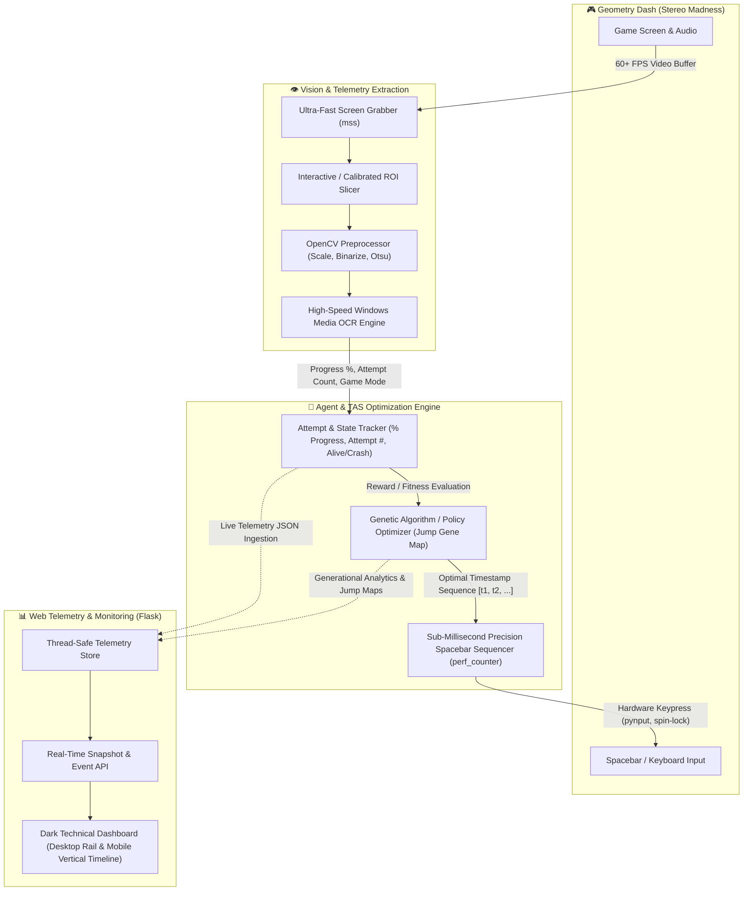

# 🚀 Geometry Dash AI — Stereo Madness Autonomous Agent & TAS

An autonomous machine-learning and Tool-Assisted Speedrun (TAS) system designed to learn, execute, and master **Geometry Dash — Stereo Madness** via non-invasive computer vision, precision hardware timing, and genetic/policy optimization.

The system combines real-time screen capture, OCR state extraction, sub-millisecond precision input dispatch, and a telemetry monitoring dashboard into a unified closed-loop pipeline.

---

## 📌 Project Vision & Architecture

The project treats Geometry Dash as a black-box environment. It does not inject DLLs, inspect process memory, or read game internals. Instead, it operates exactly like a human player with superhuman reflex precision: **it watches the screen, reads the state, computes jump timings, dispatches keyboard inputs, evaluates attempt progress, and evolves jump strategies over generations.**



---

## ⚙️ How the Complete System Will Work

When fully integrated, the system operates as a closed continuous learning loop across 5 core stages:

### 1. Vision & Screen Perception Pipeline
* **High-FPS Frame Capture**: Uses `mss` to grab video frames directly from the display buffer at 60+ FPS with minimal CPU overhead.
* **Region of Interest (ROI) Isolation**: Using calibrated coordinate maps (or the interactive `select_roi.py` utility), the system slices key HUD areas:
  * Progress percentage indicator (e.g. `73.49%`)
  * Attempt counter (e.g. `Attempt 152`)
  * Game status / Mode (e.g. `PRACTICE MODE`, `PAUSE`, `GAME OVER`)
* **Computer Vision Preprocessing**: Slices are upscaled using cubic interpolation, converted to grayscale, and binarized with adaptive thresholding to eliminate background geometry noise and particles.
* **Optical Character Recognition (OCR)**: Processed frames pass through native OS OCR engines (e.g., Windows Media OCR / Tesseract) to parse clean numeric telemetry (`float` level progress, `int` attempt index) in under 15ms.

### 2. Attempt Lifecycle & State Machine
The agent runs an internal finite-state machine (FSM):
* **IDLE / MENU**: Detects level start button or loading screen.
* **RUNNING**: Game begins at `t0 = 0.000s`. The agent monitors incremental progress.
* **COLLISION / CRASH**: Detects when level progress halts or the attempt counter increments. The crash timestamp and final percentage are logged as negative fitness penalties.
* **COMPLETED (100%)**: Detects 100% completion milestone, triggering victory logs and policy persistence.
* **RESTART**: Automatically waits for the death animation or triggers rapid restart to initiate the next attempt.

### 3. Sub-Millisecond Input & TAS Dispatcher
Geometry Dash requires frame-perfect jump execution:
* **Hybrid Spin-Sleep Timer**: Built on high-resolution system timers (`time.perf_counter()`). The dispatcher sleeps for coarse intervals and switches to CPU spin-locking within the last 1.5ms to achieve sub-millisecond input precision.
* **Input Injection**: Uses low-level keyboard controllers (`pynput` / OS virtual key events) to emit microsecond `press` and `release` spacebar commands.
* **Execution Jitter Logging**: Computes timing discrepancy (`actual_ms - target_ms`) and streams jitter offsets (e.g. `Δ +0.8ms`) to telemetry.

### 4. Machine Learning & Optimization Engine
Stereo Madness is an 85-second deterministic rhythm obstacle course. The learning system optimizes a **Jump Policy Vector**:
* **Gene Representation**: An ordered chromosome of jump timestamps `[t_1, t_2, ..., t_n]` and hold durations.
* **Fitness Function**:
  $$\text{Fitness} = (\text{Completion \%} \times 100) + \text{Bonus}_{\text{Coin}} - \text{Penalty}_{\text{Jitter}} + \text{LevelCompleteBonus}$$
* **Evolutionary Cycle**:
  1. **Population Run**: Evaluates a batch of candidate policies (e.g., population size = 10 per generation).
  2. **Frontier Extension**: Preserves successful jump timings up to the furthest crash point.
  3. **Mutation & Exploration**: Introduces micro-mutations ($\pm 5\text{ms}$ to $\pm 30\text{ms}$) and searches for the next valid jump window past the previous barrier.
  4. **Crossover**: Blends high-performing timing sequences across generations.

### 5. Real-Time Telemetry & Control Dashboard
A Flask web application serves as the visual control room:
* **Uptime & State Badging**: Real-time display of agent state (`Running`, `Evaluating`, `Paused`, `Error`), connection status (`Connected` vs `Simulated`), and uptime.
* **Generation & Learning Analytics**: Real-time Chart.js graphs tracking Best Completion % vs. Average Completion % and Fitness Evolution across generations.
* **Dual-View Adaptive Timeline**:
  * **Desktop View**: Sleek horizontal 85.0s rail showing planned obstacles, executed jumps with offset deltas, and live playhead position.
  * **Mobile View**: Chronological vertical feed auto-scrolling with the active playhead, preventing marker overlap on small screens.
* **CV Frame Hook**: Neutral placeholder ready to bind MJPEG/WebRTC streams directly from the screen capture pipeline.
* **Event Stream**: Chronological color-coded log of agent events, record milestones, collisions, and jump executions.

---

## 🗂️ Project Structure

```
hak/
├── app.py                     # Entry point for Web Dashboard & Telemetry Server
├── pyproject.toml             # Project build configuration & dependencies (uv)
├── requirements.txt           # Dashboard dependencies (Flask, Pytest)
│
├── src/                       # Production Agent & TAS modules (Integration target)
│   └── hak/
│       ├── __init__.py        # Package init
│       ├── capture.py         # [Target] Screen grabber & frame worker (mss / OpenCV)
│       ├── reader.py          # [Target] OCR engine & HUD state extraction
│       ├── agent.py           # [Target] Genetic optimizer & jump policy coordinator
│       └── controller.py      # [Target] Sub-millisecond spacebar sequencer
│
├── PoCs/                      # Validated Proof-of-Concept modules
│   ├── gd_ocr_poc.py          # Screen Reader & Windows Media OCR PoC
│   ├── select_roi.py          # Interactive DPI-aware screen ROI selector
│   ├── spacebar_timer.py      # Sub-millisecond spin-sleep spacebar dispatcher
│   └── test_spacebar_timer.py # Timing accuracy and parser tests
│
├── dashboard/                 # Flask Telemetry Engine
│   ├── __init__.py            # Flask app factory (create_app)
│   ├── routes.py              # REST API & WebSocket/snapshot routes
│   ├── telemetry.py           # Thread-safe in-memory TelemetryStore
│   ├── schemas.py             # Telemetry data schemas & DTOs
│   └── simulator.py           # Standalone mock telemetry generator
│
├── templates/
│   └── dashboard.html         # Responsive web dashboard UI
│
├── static/
│   ├── css/
│   │   └── dashboard.css      # Dark technical theme with mobile responsive rules
│   └── js/
│       ├── chart.min.js       # Local Chart.js library
│       └── dashboard.js       # Polling engine, Chart.js updates & dual timeline
│
└── tests/
    └── test_dashboard.py      # Dashboard & API automated tests
```

---

## 🔄 End-to-End Execution Flow (Future Integration)

When launching the finished system, the components collaborate seamlessly:

```
[ Operator starts Dashboard ]
         │
         ▼
python app.py  ───► Spawns Flask Web UI on http://127.0.0.1:5000
         │
[ Operator launches Agent Runner ]
         │
         ▼
python -m hak.agent --level "Stereo Madness" --dashboard-url http://127.0.0.1:5000
         │
         ├── 1. Calibrates screen coordinates & hooks ROI
         ├── 2. Connects to Dashboard (switches status to "Connected")
         ├── 3. Enters Attempt Evaluation Loop:
         │      ├── Captures t0 on level start
         │      ├── Fires planned spacebar presses via spin-sleep timer
         │      ├── OCR parses real-time % progress
         │      ├── Detects crash or win
         │      └── Posts attempt metrics & jump events to /api/telemetry/ingest
         └── 4. Evaluates Generation:
                ├── Ranks fitness scores across population
                ├── Mutates jump chromosome
                └── Repeats next generation
```

---

## 🔌 Telemetry Integration Contract

The dashboard exposes an ingestion endpoint allowing the game agent to stream data without tight coupling:

### Ingestion Endpoint: `POST /api/telemetry/ingest`

#### Example Payload: Attempt Progress & Crash
```json
{
  "session": {
    "agent_status": "Running",
    "current_generation": 8,
    "current_attempt": 72,
    "best_completion": 84.50,
    "best_fitness": 1120.4
  },
  "attempt": {
    "attempt_number": 72,
    "generation": 8,
    "level_progress": 84.50,
    "elapsed_time": 71.82,
    "outcome": "Crashed",
    "latest_action": "Jump! (Δ +0.4ms)",
    "planned_jumps_count": 35,
    "executed_jumps_count": 35,
    "jumps": [
      {
        "planned_time": 1.12,
        "executed_time": 1.1204,
        "action": "jump",
        "delta_ms": 0.4
      }
    ],
    "fitness": 1056.25
  },
  "event": {
    "category": "record",
    "message": "★ New record progress: 84.5% on attempt #72 (Triple Spike)",
    "severity": "success"
  }
}
```

---

## 🛠️ Development & Testing

### Running the Dashboard (Standalone with Simulator)
```bash
python3 app.py
```
Visit `http://127.0.0.1:5000` to inspect live mock training curves, responsive jump timelines, and event logs.

### Testing Proof-of-Concepts (PoCs)
* **Spacebar Precision Timer**:
  ```bash
  python PoCs/spacebar_timer.py --dry-run -t 500,1000,1500
  ```
* **Interactive Screen ROI Selector**:
  ```bash
  python PoCs/select_roi.py
  ```
* **OCR Screen Reader Test**:
  ```bash
  python PoCs/gd_ocr_poc.py
  ```

### Running Automated Test Suite
```bash
python3 -m pytest tests/
```
Validates telemetry ingestion, snapshot endpoints, schema models, and UI template delivery.

---

## 👥 Authors & Hackathon Team
* **1p22geo** & Team — Geometry Dash TAS / Machine-Learning System.
